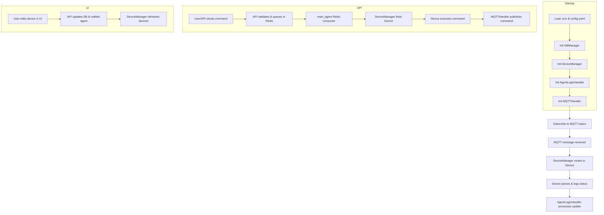

# Agentic Controller System Flow

This document provides a high-level overview and flow diagram of the Agentic Controller system, showing how configuration, device management, data flow, and agent logic interact.

---

## 1. Configuration Loading
- **config.yaml**: Defines MQTT, device list, topics, and types.
- **.env**: Provides environment variables (DB, Redis, MQTT credentials, etc).
- **main_agent.py**:
    - Loads `.env` and `config.yaml` at startup.
    - Initializes DBManager, DeviceManager, AgentLogicHandler, MQTTHandler.

---

## 2. Device Instantiation
- **DeviceManager**:
    - Reads device configs from YAML or DB.
    - For each device:
        - Looks up `type` in `_device_type_map`.
        - Instantiates the correct device class (e.g., `ParticleArgonDevice`, `ParticlePhotonDevice`).
        - Registers device and its topics for message routing.

---

## 3. Data Flow (Status Updates)
- **MQTTHandler**:
    - Subscribes to all device status topics.
    - On message:
        - Calls `DeviceManager.handle_mqtt_message(topic, payload)`.
        - DeviceManager routes to the correct device instance.
        - Device's `update_status()` parses payload, updates in-memory status, logs to DB, and calls AgentLogicHandler.

---

## 4. Command Flow
- **API Server (FastAPI)**:
    - Receives command via REST endpoint.
    - Validates device and command topic.
    - Publishes command to Redis stream.
- **main_agent.py**:
    - Redis consumer thread reads command from stream.
    - Looks up device and calls `device.execute_device_command()`.
    - Device sends command to MQTT topic.

---

## 5. Agent Logic
- **AgentLogicHandler**:
    - Receives device updates from all devices.
    - Can implement cross-device automation, logging, or trigger commands.

---

## 6. Web UI
- **FastAPI + Jinja2**:
    - Provides CRUD UI for devices.
    - Allows adding/editing devices, which updates DB and notifies agent via Redis.
    - UI reflects live device list and status.

---

## 7. Database
- **DBManager**:
    - Handles device config, status history, and current status.
    - Prunes old status history in a background thread.

---

## 8. Logging
- **Centralized logging** via `logging_config.py`.
- All modules use structured logging for traceability.

---

## 9. Extensibility
- To add a new device type:
    1. Implement a new device class (subclass `BaseDevice`).
    2. Register it in `DeviceManager._device_type_map`.
    3. Add device config to YAML or via UI.

---

## 10. High-Level Flow Diagram

---

**This document should help you visualize and reason about the full system flow.**

Feel free to expand this with more details or diagrams as your architecture evolves!
